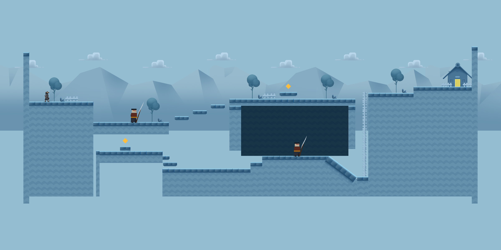

# 第一关地图试玩与编辑

场景：`Assets/HongMao/Scenes/FirstLevelGraybox.unity`，使用 Unity `6000.3.23f1`。

根据《第一关地图草稿.pdf》和 2026-10-30 的修正搭建：先复用教程素材，平台与台阶分别处理，右侧大平台内部放置掉落路线的第二只敌人，后方用不可返回的连续斜坡通向梯子。

## 打开与操作

双击场景，或使用 `HongMao > 第一关 > 打开草稿白盒`，按 Play 并点击 Game 视图。

- `A / D` 左右移动，`Space` 跳跃，鼠标左键普通攻击。
- 梯子底部按住 `W` 上爬，`S` 下爬。
- `Enter` 从出生点重开。
- 右端房屋门口为出口，到达后完成；死亡或掉出地图后可重开。

玩家画面没有草稿文字、路线箭头、区域设计意图或“白盒测试”标题。HUD 仅显示体力、收集数量及重开／完成状态。

## 素材与地形

环境复用项目内 `Assets/HongMao/Art/Environment/TutorialPlatformer/` 的地面、浮台、远山、云、树、植物、围栏和房屋。来源见该目录的 `SOURCE.md`。梯子使用旋转、拼接后的围栏素材；奖励仍暂用金色菱形，角色和敌人沿用既有 Prefab。

- 起点是顶面 y=3.5、下延至 y=-12.8 的高平台。
- 普攻区域顶面 y=0，有实体厚度；其下方另留探索空间。
- 三块独立跳跃平台顶面为 y=1、2、3，平台本身厚约 0.9；不会把浮台堆成连续阶梯。
- 右侧大平台上表面 y=4，由顶部、两侧支撑与下部基座形成中空结构。中空区域可实际进入，第二只敌人在其中的 y=-5.8 地面活动。
- 只有下层入口保留草稿中的地形台阶，用于接入中空区域。
- 中空区域后方是一段从 `(48.5, -5.8)` 到 `(53.3, -9.4)` 的连续斜坡，使用单个 PolygonCollider2D，没有阶梯碰撞。
- 角色接触斜坡后沿坡滑下；反向移动、跳跃或闪避不能借斜坡回到上方。坡底正常恢复操作，可向梯子移动。
- 梯子底部落脚点 `(54.6, -8.47)`，顶部落脚点 `(56.9, 5.93)`；回到主路后越过最后一段高差抵达房屋。

主路线：起点 → 下落至普攻区域 → 独立跳台 → 右侧大平台顶部／上层奖励 → 跨过梯口 → 终点房屋。

掉落路线：跳跃失误或主动下落 → 左侧探索奖励／下层通路 → 中空区域与第二只敌人 → 连续下滑斜坡 → 爬梯回主路 → 终点房屋。

奖励不是通关条件。当前未加入战斗锁门、剧情、检查点或下一关切换；第二只敌人和较长的恢复路线构成失误后的额外代价。

## 编辑入口

- `World/Geometry`：每个大平台／浮台独立分组，根对象碰撞与子对象教程贴图一起移动。
- `World/Geometry/06 Hollow right platform`：顶面、左右支撑和内部地面。调整时保留角色所需的净空。
- `World/Geometry/15 One-way slide`：斜坡碰撞、贴图和 `FirstLevelSlide`。修改形状时同步修改滑行组件的世界坐标起止点。
- `World/Actors`：玩家与两只敌人的场景实例。
- `World/Rewards`：两处收集品。
- `World/Level References`：出口与敌人活动范围，仅为逻辑引用，不向玩家显示设计标识。
- `World/Recovery Ladder`：梯子素材和两个落脚点。
- `World/Decoration`：天空、远景、植被、洞室背墙及出口房屋，均无碰撞。
- `First Level Systems`：场景引用、体力／奖励、完成失败及重开流程。

地形使用本关独立的零摩擦物理材质，避免贴墙起跳被摩擦阻挡。玩家与敌人不发生实体推挤，命中仍由既有攻击查询处理；已击败敌人不会堵路。公共 Prefab 与玩家跳跃参数保持原值。

已有场景直接编辑并保存。首次创建命令拒绝覆盖场景；本次改版保留原场景 GUID、角色引用和 Prefab 关联。改版前副本留在被 Git 忽略的 `Builds/FirstLevelValidation/BeforeTutorialRevision.unity`。

本关仍用于 Editor 试玩，未加入构建场景列表；以后独立构建时需在对应 Build Profile 中添加。

## 验证记录

2026-10-30 本轮修正后的地形已重新验证：Unity 编译通过，完整 PlayMode **20/20** 通过，其中第一关 **9/9**。

验证包括：没有玩家可见的草图说明、教程素材引用、大平台体量、中空区域的实际净空、主路连跳、下层战斗、斜坡下滑和反向尝试、梯子、出口、奖励与重开。自动化测试位于 `Assets/HongMao/Tests/PlayMode/FirstLevelTests.cs`。

全景和运行中相机截图位于 `Builds/FirstLevelValidation/`。批处理截图使用 Camera.Render 回退时不包含 IMGUI HUD；实际窗口画面另行检查。

已在实际 Unity Editor 的 Game 画面中从出生点进入下层，跳入中空战斗区，经过第二只怪物后滑下斜坡，在坡底尝试反向行走，并按 W 爬梯返回上层。玩家画面无草稿文字和箭头，教程贴图与简化 HUD 显示正常。退出 Play Mode 后 Console：0 Error、0 Warning。
